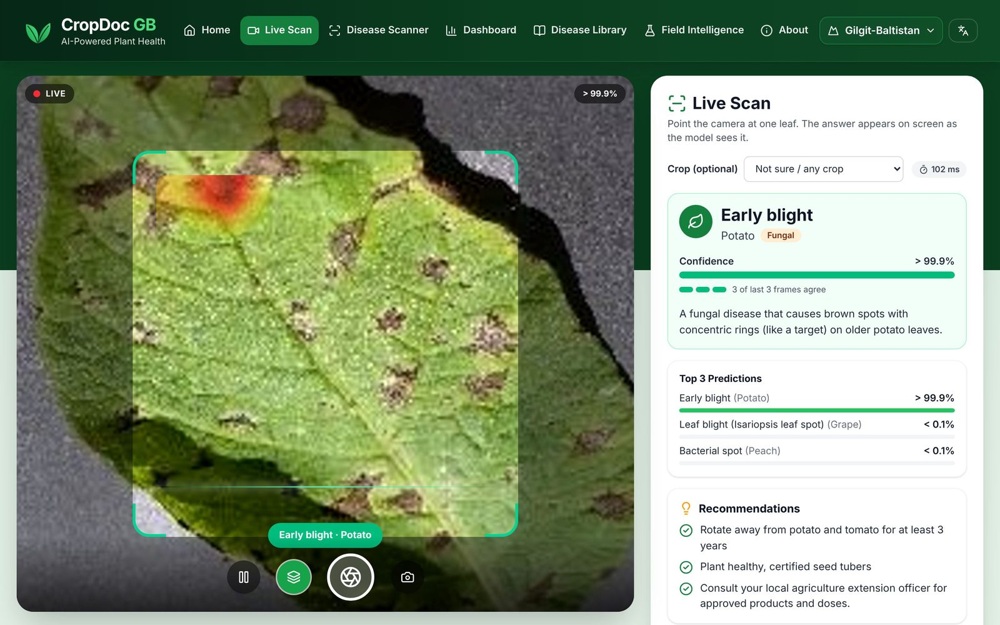
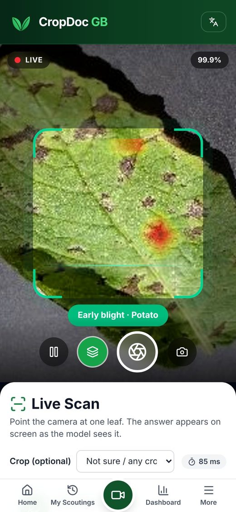
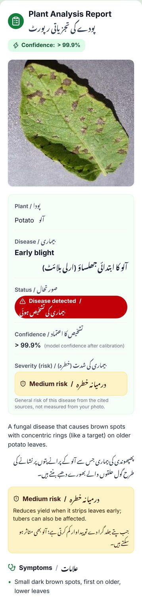
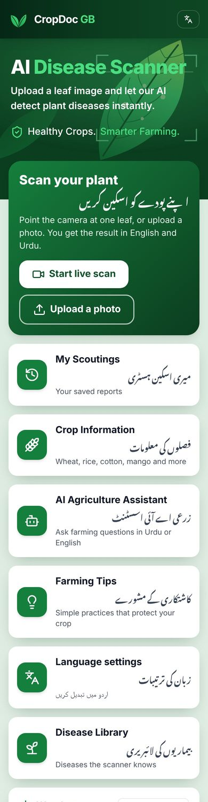
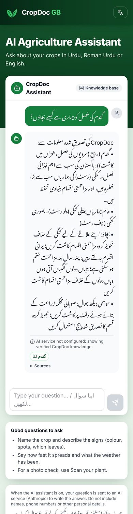

# CropDoc GB: AI Plant Disease Scanner for Gilgit-Baltistan

Point your phone or laptop camera at a leaf and CropDoc GB names the likely disease **live, on screen,
like a scanner**, or upload a photo for a full **Plant Analysis Report in English and Urdu on the same
screen**. It shows **where the AI looked** (Grad-CAM heatmap), gives an **honest confidence** with a "not
sure, ask an expert" warning, and asks for **another photo** when a picture is too dark, too bright or blurry.
Farmers also get a **treatment guide** (cultural practices and safe steps, never product names or doses),
an **agriculture assistant** that answers in Urdu or English, **crop information** for 9 Pakistani crops,
**farming tips** and the **weather**. It runs privately on your own computer. Behind the app is a measured
study of the problem most plant-disease demos hide: **models trained on clean lab photos fail on real
field photos.**

> General guidance only, not a diagnosis. Please consult an agriculture expert.

| Live Scan on a laptop | Live Scan on a phone |
|---|---|
|  |  |

The screenshots come from the automated end-to-end test (`frontend/e2e/live.spec.ts`): a fake webcam shows a PlantVillage
*test* photo of potato early blight and the real model answers every frame.

| Plant Analysis Report (English + Urdu) | Farmer dashboard | Agriculture assistant |
|---|---|---|
|  |  |  |


## Quick start

| Windows | macOS / Linux |
|---|---|
| 1. Install [Python 3.11](https://www.python.org/downloads/) (tick "Add python.exe to PATH") | 1. Install Python 3.11 |
| 2. Unzip `cropdoc-gb-complete.zip` | 2. Unzip and open a terminal in the folder |
| 3. Double-click **`start.bat`** | 3. Run `./start.sh` |

The first start installs about 50 MB of libraries (internet needed), then the browser opens
**http://127.0.0.1:8000**. Later starts work offline. Docker: `docker compose up --build`.

### Live Scan (camera)
Open **Live Scan** (top menu, or the green camera button at the bottom on a phone) and allow the camera.
1. Hold the camera about a hand-span from **one** leaf and fit it inside the box.
2. About twice a second the box's contents go to the model (same model, calibration and safety thresholds as the photo
   scanner). The box turns **green** and the disease name appears once **2 of the last 3 frames agree** confidently;
   amber means "not sure, move closer", red means "no supported leaf".
3. The panel shows the disease, crop, calibrated confidence, top-3, description and cultural guidance; the
   heatmap button shows where the model is looking.
4. Tap the round button to **save a full report** (with Grad-CAM) to My Scoutings.

Live frames are never stored. Buttons: pause, heatmap, flashlight (phones that support it), switch camera, take a photo.

### Use it on your phone
Browsers allow the live camera only on `https://` addresses (or on `localhost`). So for a phone on the same Wi-Fi:

| Windows | macOS / Linux |
|---|---|
| Double-click **`start-phone.bat`** | Run `./start.sh --phone` |

The console prints an address such as `https://192.168.1.20:8443`, and **Live Scan on the laptop shows a QR code** for
it. Open it on the phone. The first time the phone warns "connection not private" because the computer made its own
certificate: tap **Advanced → Proceed**. Photos stay on your Wi-Fi. If Windows asks about the firewall, allow
**Private networks**. On the phone, "Add to Home screen" installs it like an app.

To use it anywhere without the laptop, deploy it to a free HTTPS host (Hugging Face Spaces, Render or Vercel):
see [`docs/deploy.md`](docs/deploy.md).

### Agriculture assistant (optional AI key)
The **Assistant** page answers questions such as "گندم کی فصل کو بیماری سے کیسے بچاؤں؟" or "tamatar ke pattay
peelay hain": in Urdu for Urdu or Roman Urdu questions, in English for English ones. It always searches the CropDoc
knowledge base first (diseases, crops, tips with sources). It works in two modes:
- **Without a key (default):** it shows a short summary of the best-matching verified entries. It works offline.
- **With an Anthropic API key:** Claude writes a short answer **only from those passages**, asks a follow-up question
  when the crop or symptoms are unclear, and follows the same safety rules (no product names or doses). Before
  starting, set the key in the console (never put it in a file you share):

  | Windows (cmd) | macOS / Linux |
  |---|---|
  | `set ANTHROPIC_API_KEY=sk-ant-...` then `start.bat` | `export ANTHROPIC_API_KEY=sk-ant-...` then `./start.sh` |

  When the key is set, questions are sent to Anthropic to write the answer, and the page says so. If the service is
  unreachable, the assistant falls back to the knowledge base. Optional: `CROPDOC_ASSISTANT_MODEL` (default
  `claude-opus-5-5`) and `CROPDOC_ASSISTANT_EFFORT` (default `medium`).

The **weather card** uses the free [Open-Meteo](https://open-meteo.com) service (no key, internet needed). Your
location is rounded to about 10 km before it leaves the computer. Turn it off with `CROPDOC_WEATHER=off`.

## Troubleshooting
- **"The AI engine (ONNX Runtime) could not start … DLL load failed" (Windows):** install the latest
  [Microsoft Visual C++ Redistributable (x64)](https://aka.ms/vs/17/release/vc_redist.x64.exe), restart if asked,
  and run `start.bat` again. `start.bat` detects this and offers to install it for you with `winget`.
  If it still fails:
  - make sure you installed **64-bit Python 3.11 from python.org** (not Anaconda, not the Microsoft Store);
  - delete the `.venv` folder next to `start.bat` and run `start.bat` again (it reinstalls cleanly);
  - check whether an old `onnxruntime.dll` sits in `C:\Windows\System32` (some programs put one there).
- **The browser does not open:** go to http://127.0.0.1:8000 yourself. If port 8000 is busy, the console
  shows the port it used instead.
- **"Model not loaded":** the `models/active/` folder is missing or incomplete; unzip the package again.
- **Live Scan says "Live camera needs a secure link" on a phone:** you opened an `http://` address. Start with
  `start-phone.bat` / `./start.sh --phone` and open the `https://` address it prints (or deploy, `docs/deploy.md`).
  "Take a photo" still works meanwhile.
- **"Camera permission is blocked":** tap the lock icon in the address bar → Permissions → Camera → Allow, then reload.
- **"Camera is busy":** close video-call or camera apps that are using it.
- **Deployed on Vercel but it does not work:** in Settings → Build and Deployment, **Root Directory must be empty** (the
  repository root, not `backend` or `frontend`) and Framework Preset `FastAPI`; then redeploy without the build cache. Check `https://<project>.vercel.app/api/health`.
  Details: [`docs/deploy.md`](docs/deploy.md#option-c-vercel-free-serverless).
- **The phone cannot open the address:** both devices must be on the same Wi-Fi (not a guest network that isolates
  devices), and the firewall must allow Python on private networks.

## The headline finding: the lab → field gap
The deployed model is excellent on lab photos and poor on real-world photos of the **same 28 diseases**:
<!-- BEGIN:headline_gap -->
| Same 28 classes | Lab photos (PlantVillage test) | Real-world photos (PlantDoc) | Real-world + crop hint |
|---|---|---|---|
| Accuracy | 98.1% | 20.8% | 50.7% |
| Macro-F1 | 0.982 | 0.198 | 0.510 |
| Calibration error (ECE) | 0.003 | 0.501 | — |
| App says 'confident' | 93.2% | 14.3% | — |
| …and is right when confident | 99.0% | 42.5% | — |
| Photos | 5,774 | 2,578 | 2,578 |

Accuracy drop lab → real-world: **77.2 (95% CI 75.6 to 78.9) points**. PlantDoc photos identical to a PlantVillage photo: 0.

_Source: `results/shift/plantdoc_gap.json` (deployed model; PlantDoc = public web photos, not GB photos)._
<!-- END:headline_gap -->

**What helps (measured):**
- **Telling the app the crop** (the crop selector) is free and is the biggest single gain above.
- **A few real-world photos per class** recover much of the gap (few-shot adaptation):
<!-- BEGIN:fewshot_table -->
| k real-world photos per class | Accuracy (mean ± std, 3 seeds) | Macro-F1 | Accuracy with crop hint |
|---|---|---|---|
| 0 | 26.8% ± 0.2 | 0.245 | 52.7% ± 0.2 |
| 5 | 40.4% ± 6.5 | 0.395 | 65.4% ± 3.0 |
| 10 | 44.2% ± 3.6 | 0.441 | 66.7% ± 2.3 |
| 20 | 46.8% ± 1.5 | 0.468 | 67.8% ± 1.5 |

Evaluated on 236 held-out PlantDoc test photos (27 classes); 21 pool photos that nearly duplicated an evaluation photo were removed first. Model: frozen ImageNet MobileNetV3-Large features + linear head (lab-trained, then adapted).

_Source: `results/shift/fewshot_plantdoc.json`, figure `results/shift/fewshot_plantdoc.png`._
<!-- END:fewshot_table -->
- **Honest uncertainty:** the app's thresholds (chosen on validation data only) now flag most real-world
  photos as "not sure / unsupported" instead of answering wrongly with confidence:
<!-- BEGIN:ood_table -->
| Unfamiliar input | AUROC (max-softmax) | AUROC (energy) | Photos |
|---|---|---|---|
| Unseen diseases (4 held out) | 0.808 | 0.770 | 638 |
| Non-leaf photos (everyday objects) | 0.976 | 0.991 | 985 |
| Real-world leaf photos (PlantDoc) vs lab photos | 0.956 | 0.967 | 2,578 |

With the thresholds now used by the app (chosen on validation data only): lab photos are answered confidently 94.0% of the time; real-world photos 14.3%; non-leaf photos 2.8%. The rest get "not sure" or "unsupported".

_Source: `results/ood/ood_summary.json`, `results/calibration/thresholds.json`._
<!-- END:ood_table -->

**Why it happens (shortcut learning):** PlantVillage photos of a class share the same plain background.
<!-- BEGIN:shortcut -->
- A classifier that sees **only the background** (leaf pixels removed) reaches 59.8% accuracy; one that sees only an 8-pixel border reaches 61.4% (chance: 2.6%, majority class: 3.2%).
- Deployed model, leaf painted grey (background only): 24.3% accuracy; background removed (leaf on black): 82.8%; original photos: 98.4%.
- Grad-CAM: 28.5% of the heat falls outside the leaf, while the background covers 40.8% of the image (median ratio 0.67; below 1 = focused on the leaf).

_Source: `results/background/background_summary.json`, `results/explain/cam_outside_leaf.json`._
<!-- END:shortcut -->

### Can training with real-world photos close the gap? (model v2)
Model v2 learned from lab photos **and** real-world photos (PlantDoc's own group-aware train split, 1,545 photos),
with background randomization so the plain lab background stops being a shortcut (`make train-field`, about
45 minutes on 4 CPU cores). The deployment rules were written down **before** any test result was seen
(`docs/decisions.md`, D22). Both models were then tested once on the same unseen photos:
<!-- BEGIN:field_model -->
| Measure | v1 (deployed, lab photos only) | v2 (lab + real-world photos) |
|---|---|---|
| Lab test photos: accuracy | 98.3% | 97.3% |
| Lab test photos: macro-F1 | 0.981 | 0.967 |
| Real-world test photos: accuracy | 23.4% | 68.1% |
| Real-world test photos: macro-F1 | 0.227 | 0.678 |
| Real-world: calibration error (ECE) | 0.479 | 0.074 |
| Real-world: share answered 'confident' | 14.7% | 52.3% |
| Real-world: accuracy when 'confident' | 44.2% | 85.2% |
| Non-leaf photos answered 'confident' | 2.8% | 3.7% |

Test photos: 8,145 lab, 646 real-world (PlantDoc web photos, not Gilgit-Baltistan). Real-world accuracy difference v2 − v1: +44.7 points (95% CI +40.1 to +49.2); lab: -1.0 points (95% CI -1.4 to -0.7). Rules: real-world macro-F1 gain 45.12 points (rule: ≥ 5.00 points) ✓; lab macro-F1 drop 1.37 points (rule: ≤ 1.00 points) ✗; non-leaf photos answered 'confident' 3.7% (rule: ≤ 5.0%) ✓. **v2 is not deployed**: it failed a rule fixed before testing, so the app keeps v1.

_Source: `results/field_model/summary.json` (from `comparison.json`)._
<!-- END:field_model -->

v2 is far better on real-world photos, but it missed the pre-registered lab rule (macro-F1 may drop by at most
1 point), so **the app still uses v1**. The rule is not changed after the fact; whether to deploy v2 anyway is the
owner's decision and would be logged in `docs/decisions.md`. Remaining v2 mistakes are mostly between look-alike
diseases (corn gray leaf spot vs northern leaf blight, tomato septoria vs bacterial spot, potato vs tomato late
blight): see the confusion matrices in `results/field_model/`. **Class imbalance**
(`results/data_audit/class_balance.json`): lab training photos per class range from 108 to 3,854 and real-world ones
from 2 to 115, and 10 classes have no real-world photos at all. v2's fine-tuning draws at most 200 lab photos per class
per epoch, and every comparison uses macro-F1, which counts each class equally.


## Why this matters in Gilgit-Baltistan
Potato, apple, cherry, apricot, maize and tomato support many households in GB, while agriculture experts are
few and far between in the valleys. An app that flags a likely disease early, and says honestly when it is
unsure, can help a farmer decide when to call the extension officer. It is only useful if its confidence can be
trusted on *real* field photos, which is why the field study comes first.

## What the app does
- **Plant Analysis Report (English + Urdu side by side):** plant, disease, status, confidence and severity (risk) in a
  table, then symptoms, possible causes and recommended actions in both languages, with buttons for the full details,
  the treatment guide, the assistant, saving and scanning another plant.
- **Photo check:** too dark, too bright or blurry photos get "please take another photo" with advice, and no disease is
  shown or saved. The limits were measured on real validation photos (`results/quality/quality_summary.json`).
- **Treatment guide:** overview, early and advanced symptoms, causes and spread, immediate actions, prevention,
  generic treatment categories, safety and when to call an expert. Cultural practices only: no product names, doses
  or spray schedules ("consult your local agriculture extension officer").
- **Agriculture assistant:** questions in Urdu, Roman Urdu or English; grounded in the knowledge base with sources.
- **Crop information:** wheat, rice, cotton, sugarcane, tomato, potato, maize, mango and citrus: common diseases,
  prevention and seasonal care in English and Urdu, from cited sources. **Farming tips** from FAO guidance.
- **Farmer dashboard:** big buttons for scanning, history, crops, assistant, tips and language, plus local weather.
- **Live Scan:** point the camera at a leaf and the answer appears on screen within about a second, with a scan box
  that turns green when 2 of the last 3 frames agree, a live heatmap, flashlight and camera switch. Works on laptops
  (webcam) and phones (back camera); one tap saves a full report.
- **Scan a photo:** drag-and-drop, file picker or camera; optional crop hint; top-3 predictions with calibrated probabilities.
- **Explain:** a Grad-CAM heatmap with an opacity slider.
- **Be honest:** "Not sure, please consult an agriculture expert" and "unsupported" warnings (non-leaves, crops such as apricot that the model does not know).
- **Remember:** My Scoutings history (search, filter, compare with a reference photo, delete, feedback) and a dashboard computed only from your saved scans.
- **Learn:** a disease library (symptoms, spread, cultural management, cited extension sources) and Field Intelligence (the research results).
- **Accessible:** English and Urdu (right-to-left), phone layout, installable PWA. There are no accounts, and GPS/EXIF data is removed from every photo.

## Model and data
<!-- BEGIN:quick_metrics -->
| Metric | Value |
|---|---|
| Test accuracy (group-aware split, lab photos) | 98.31% |
| Test macro-F1 | 0.981 |
| Test photos | 8,145 |
| Validation accuracy / macro-F1 | 98.37% / 0.980 |
| Calibration error (ECE) before → after temperature | 0.0032 → 0.0030 |
| Temperature (fitted on validation) | 1.033 |
| 'Confident' threshold / test coverage / accuracy when confident | 0.64 / 98.8% / 98.9% |
| Training time (CPU only) | 15.6 min |
| Model | MobileNetV3-Large (ImageNet-pretrained, timm) + global-average-pool + linear head · `quick-mbv3l-2026-11-09` |

_Source: `results/quick_model/metrics.json`, `models/active/model_card.json`._
<!-- END:quick_metrics -->

<!-- BEGIN:data_facts -->
- 54,305 PlantVillage photos in 38 classes (152–5507 per class).
- 41,479 photos belong to groups of the same physical leaf (official leaf map + near-duplicate detection); 20,671 groups in total.
- A naive random split puts a same-leaf sibling of **74.8%** of test photos into training (6,092 of 8,146).
- Group-aware split used for every reported number: 38,010 train / 8,150 val / 8,145 test, 0 groups crossing splits (SHA256 `c45b4f872b70…`).

_Source: `results/data_audit/`, `ml/splits/manifest.json`._
<!-- END:data_facts -->

**Leakage check (naive vs group-aware split).** The inflation is real but small for PlantVillage, and largest for
models that memorize:
<!-- BEGIN:leakage_table -->
| Model | Naive split acc. | Group-aware acc. | Inflation (points) | Seeds |
|---|---|---|---|---|
| Frozen CNN features + linear head | 98.6% ± 0.1 | 98.3% ± 0.1 | +0.2 | 3 |
| 1-nearest-neighbour on CNN features | 96.2% ± 0.0 | 94.1% ± 0.0 | +2.0 | 1 |
| Classical features + random forest | 90.8% ± 0.1 | 90.0% ± 0.2 | +0.8 | 3 |
| Tiny MLP (ANN) on 32x32 pixels | 85.7% ± 0.1 | 84.6% ± 0.1 | +1.1 | 3 |
| Classical features + logistic regression | 84.1% ± 0.0 | 83.2% ± 0.0 | +0.9 | 1 |

Inside the naive test set, photos whose leaf-sibling is in training are classified 98.9% correctly vs 97.8% for photos without one (74.8% of naive test photos are exposed).

_Source: `results/leakage/leakage_summary.json`, `results/baselines/baselines.json`._
<!-- END:leakage_table -->

**Deployment:** <!-- BEGIN:export -->
ONNX model 12.02 MB; CPU latency per photo 5.62 ms (1 thread) / 6.36 ms (all threads), median of 50 runs on the build machine. ONNX vs PyTorch max |Δlogit| = 2.6e-05 on 16 test photos.

_Source: `results/export/benchmark.json`, `results/export/parity.json`._
<!-- END:export -->

## Experiment matrix (Colab GPU)
<!-- BEGIN:sweep_table -->
**PENDING**: requires the Colab GPU sweep (`ml/notebooks/colab_run.ipynb`): 3 models × 4 augmentations × 3 seeds on the group-aware split, plus naive-split, imbalance, combined-augmentation and unseen-disease blocks.
<!-- END:sweep_table -->

## Research status
<!-- BEGIN:research_status -->
| Study | Status | Result file |
|---|---|---|
| Leakage: naive vs group-aware split | ready | `results/leakage/leakage_summary.json` |
| Background uniformity / background-only probe | ready | `results/background/background_summary.json` |
| Lab → real-world photos (PlantDoc) | ready | `results/shift/plantdoc_gap.json` |
| Model v2 trained with real-world photos (v1 vs v2) | ready | `results/field_model/summary.json` |
| Lab → Gilgit-Baltistan field photos | **PENDING** | `results/shift/field_gap.json` |
| Calibration (ECE, reliability) | ready | `results/calibration/calibration_summary.json` |
| OOD detection (AUROC) | ready | `results/ood/ood_summary.json` |
| Few-shot adaptation (PlantDoc) | ready | `results/shift/fewshot_plantdoc.json` |
| Few-shot adaptation (GB photos) | **PENDING** | `results/shift/fewshot_field.json` |
| Grad-CAM mass outside the leaf | ready | `results/explain/cam_outside_leaf.json` |
| Model × augmentation sweep (3 seeds, Colab) | **PENDING** | `results/sweep/summary.json` |
<!-- END:research_status -->

## Limitations (honest)
- The deployed model is a **quick CPU-trained** model trained only on lab photos. Real-world accuracy is low (see above),
  so treat any answer on a field photo as a hint, not a result. Model v2 is much better on real-world photos but is
  not deployed because it missed a pre-registered lab-accuracy rule (see "model v2" above).
- The photo check only measures light and sharpness. It cannot tell whether a sharp photo shows the right leaf; the
  "unsupported" warning handles that, and it is not perfect either.
- Severity (risk) is the disease's general potential for loss from the cited sources, **not** a measurement of how
  badly this plant is affected.
- The assistant answers only from the CropDoc knowledge base. In AI mode the wording is written by an AI model and can
  still be wrong; it always points to the extension officer for products and doses.
- Real-world results so far come from **PlantDoc web photos, not Gilgit-Baltistan photos**. The GB study is PENDING
  until field photos are collected (`docs/field_collection_guide.md`).
- The scanner covers 38 classes from 14 crops. Apricot, walnut, mulberry, wheat, rice, cotton, sugarcane, mango, citrus
  and other local crops are not recognised by the scanner (the crop pages still give information about them).
- Disease, crop and tip content was drafted from cited sources and is **awaiting expert review** (`needs_review`). All
  Urdu text (interface, reports, crops, tips) is machine-written and needs review by a native speaker.

## Ethics
CropDoc GB is **not a replacement for agronomists or agriculture extension officers**. It never names chemical
products or doses (enforced by a test). Photos and history stay on the device. Contributed field photos are used
only with consent and after an expert has checked the label.

## Reproduce
- **App:** the quick start above (`make phone` = phone mode for developers).
- **Developers:** `make setup` (Python 3.11 + Node 22), `make data` (PlantVillage + PlantDoc, no API keys), `make split`,
  `make train` (about 15 minutes on 4 CPU cores), `make research` (every CPU experiment), `make report`, `make test`,
  `make e2e`, `make package`.
- **GPU sweep:** `ml/notebooks/colab_run.ipynb` on free Colab (T4). It resumes after disconnects; `make promote` swaps in a
  better model only if it beats the current one on the group-aware test split.
- Pre-registered comparisons: `docs/preregistration.md`. Decisions with evidence: `docs/decisions.md`.

## Project structure
```
backend/   FastAPI app (ONNX Runtime inference, Grad-CAM, photo check, SQLite history, bilingual knowledge, assistant, weather)
frontend/  React + Vite + TypeScript + Tailwind (Live Scan, scanner, report, assistant, crops, tips, EN/UR, PWA), vitest + Playwright
ml/        cropdoc package: data, models, train, sweep, evaluate, calibration, research/*, configs, Colab notebook
models/active/  deployed ONNX model + model card + calibration (thresholds)
results/   every metric and plot as JSON/CSV/PNG: the only source of numbers in the docs and UI
docs/      PLAN, decisions, preregistration, api, deploy, field_collection_guide
scripts/   download_data, train_quick, package, fresh_install_test, prepare_ui_assets
```

## Credits and licenses
Code: MIT. Leaf photos: [PlantVillage](https://github.com/spMohanty/PlantVillage-Dataset) (CC BY-SA 3.0). Real-world test
photos: [PlantDoc](https://github.com/pratikkayal/PlantDoc-Dataset) (CC BY 4.0). Non-leaf test photos: ImageNet
one-per-class sample (evaluation only, not redistributed). Pretrained weights: [timm](https://github.com/huggingface/pytorch-image-models) (Apache 2.0).
