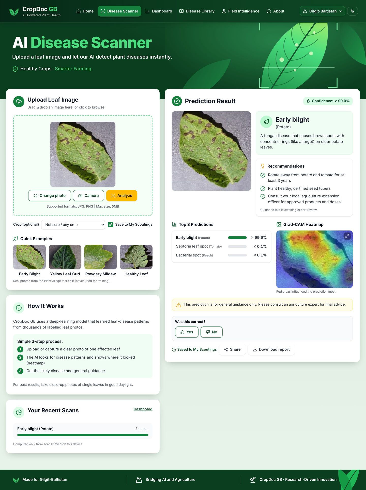
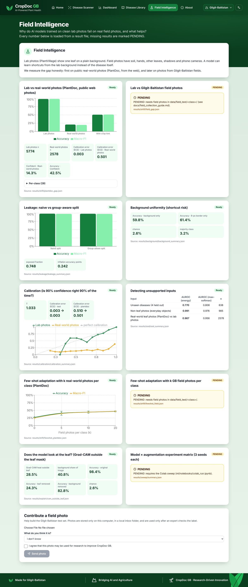

# CropDoc GB: AI Plant Disease Scanner for Gilgit-Baltistan

Photograph a leaf and CropDoc GB names the likely disease. It shows **where the AI looked**
(Grad-CAM heatmap) and gives an **honest confidence** with a "not sure, ask an expert" warning. It
also offers **general care guidance** with sources. It runs privately on your own computer. Behind
the app is a measured study of the problem most plant-disease demos hide: **models trained on clean
lab photos fail on real field photos.**

> General guidance only, not a diagnosis. Please consult an agriculture expert.



## Quick start

| Windows | macOS / Linux |
|---|---|
| 1. Install [Python 3.11](https://www.python.org/downloads/) (tick "Add python.exe to PATH") | 1. Install Python 3.11 |
| 2. Unzip `cropdoc-gb-complete.zip` | 2. Unzip and open a terminal in the folder |
| 3. Double-click **`start.bat`** | 3. Run `./start.sh` |

The first start installs about 50 MB of libraries (internet needed), then the browser opens
**http://127.0.0.1:8000**. Later starts work offline. Docker: `docker compose up --build`.

## The headline finding: the lab → field gap
The deployed model is excellent on lab photos and poor on real-world photos of the **same 28 diseases**:
<!-- BEGIN:headline_gap -->
| Same 28 classes | Lab photos (PlantVillage test) | Real-world photos (PlantDoc) | Real-world + crop hint |
|---|---|---|---|
| Accuracy | 98.1% | 20.8% | 50.7% |
| Macro-F1 | 0.982 | 0.198 | 0.510 |
| Calibration error (ECE) | 0.003 | 0.501 | — |
| App says 'confident' | 93.2% | 14.3% | — |
| …and is right when confident | 99.0% | 42.5% | — |
| Photos | 5,774 | 2,578 | 2,578 |

Accuracy drop lab → real-world: **77.2 (95% CI 75.6 to 78.9) points**. PlantDoc photos identical to a PlantVillage photo: 0.

_Source: `results/shift/plantdoc_gap.json` (deployed model; PlantDoc = public web photos, not GB photos)._
<!-- END:headline_gap -->

**What helps (measured):**
- **Telling the app the crop** (the crop selector) is free and is the biggest single gain above.
- **A few real-world photos per class** recover much of the gap (few-shot adaptation):
<!-- BEGIN:fewshot_table -->
| k real-world photos per class | Accuracy (mean ± std, 3 seeds) | Macro-F1 | Accuracy with crop hint |
|---|---|---|---|
| 0 | 26.8% ± 0.2 | 0.245 | 52.7% ± 0.2 |
| 5 | 40.4% ± 6.5 | 0.395 | 65.4% ± 3.0 |
| 10 | 44.2% ± 3.6 | 0.441 | 66.7% ± 2.3 |
| 20 | 46.8% ± 1.5 | 0.468 | 67.8% ± 1.5 |

Evaluated on 236 held-out PlantDoc test photos (27 classes); 21 pool photos that nearly duplicated an evaluation photo were removed first. Model: frozen ImageNet MobileNetV3-Large features + linear head (lab-trained, then adapted).

_Source: `results/shift/fewshot_plantdoc.json`, figure `results/shift/fewshot_plantdoc.png`._
<!-- END:fewshot_table -->
- **Honest uncertainty:** the app's thresholds (chosen on validation data only) now flag most real-world
  photos as "not sure / unsupported" instead of answering wrongly with confidence:
<!-- BEGIN:ood_table -->
| Unfamiliar input | AUROC (max-softmax) | AUROC (energy) | Photos |
|---|---|---|---|
| Unseen diseases (4 held out) | 0.808 | 0.770 | 638 |
| Non-leaf photos (everyday objects) | 0.976 | 0.991 | 985 |
| Real-world leaf photos (PlantDoc) vs lab photos | 0.956 | 0.967 | 2,578 |

With the thresholds now used by the app (chosen on validation data only): lab photos are answered confidently 94.0% of the time; real-world photos 14.3%; non-leaf photos 2.8%. The rest get "not sure" or "unsupported".

_Source: `results/ood/ood_summary.json`, `results/calibration/thresholds.json`._
<!-- END:ood_table -->

**Why it happens (shortcut learning):** PlantVillage photos of a class share the same plain background.
<!-- BEGIN:shortcut -->
- A classifier that sees **only the background** (leaf pixels removed) reaches 59.8% accuracy; one that sees only an 8-pixel border reaches 61.4% (chance: 2.6%, majority class: 3.2%).
- Deployed model, leaf painted grey (background only): 24.3% accuracy; background removed (leaf on black): 82.8%; original photos: 98.4%.
- Grad-CAM: 28.5% of the heat falls outside the leaf, while the background covers 40.8% of the image (median ratio 0.67; below 1 = focused on the leaf).

_Source: `results/background/background_summary.json`, `results/explain/cam_outside_leaf.json`._
<!-- END:shortcut -->



## Why this matters in Gilgit-Baltistan
Potato, apple, cherry, apricot, maize and tomato support many households in GB, while agriculture experts are
few and far between in the valleys. An app that flags a likely disease early, and says honestly when it is
unsure, can help a farmer decide when to call the extension officer. It is only useful if its confidence can be
trusted on *real* field photos, which is why the field study comes first.

## What the app does
- **Scan:** drag-and-drop, file picker or camera; optional crop hint; top-3 predictions with calibrated probabilities.
- **Explain:** a Grad-CAM heatmap with an opacity slider.
- **Be honest:** "Not sure, please consult an agriculture expert" and "unsupported" warnings (non-leaves, crops such as apricot that the model does not know).
- **Remember:** My Scoutings history (search, filter, compare with a reference photo, delete, feedback) and a dashboard computed only from your saved scans.
- **Learn:** a disease library (symptoms, spread, cultural management, cited extension sources) and Field Intelligence (the research results).
- **Accessible:** English and Urdu (right-to-left), phone layout, installable PWA. There are no accounts, and GPS/EXIF data is removed from every photo.

## Model and data
<!-- BEGIN:quick_metrics -->
| Metric | Value |
|---|---|
| Test accuracy (group-aware split, lab photos) | 98.31% |
| Test macro-F1 | 0.981 |
| Test photos | 8,145 |
| Validation accuracy / macro-F1 | 98.37% / 0.980 |
| Calibration error (ECE) before → after temperature | 0.0032 → 0.0030 |
| Temperature (fitted on validation) | 1.033 |
| 'Confident' threshold / test coverage / accuracy when confident | 0.64 / 98.8% / 98.9% |
| Training time (CPU only) | 15.6 min |
| Model | MobileNetV3-Large (ImageNet-pretrained, timm) + global-average-pool + linear head · `quick-mbv3l-2026-11-09` |

_Source: `results/quick_model/metrics.json`, `models/active/model_card.json`._
<!-- END:quick_metrics -->

<!-- BEGIN:data_facts -->
- 54,305 PlantVillage photos in 38 classes (152–5507 per class).
- 41,479 photos belong to groups of the same physical leaf (official leaf map + near-duplicate detection); 20,671 groups in total.
- A naive random split puts a same-leaf sibling of **74.8%** of test photos into training (6,092 of 8,146).
- Group-aware split used for every reported number: 38,010 train / 8,150 val / 8,145 test, 0 groups crossing splits (SHA256 `c45b4f872b70…`).

_Source: `results/data_audit/`, `ml/splits/manifest.json`._
<!-- END:data_facts -->

**Leakage check (naive vs group-aware split).** The inflation is real but small for PlantVillage, and largest for
models that memorize:
<!-- BEGIN:leakage_table -->
| Model | Naive split acc. | Group-aware acc. | Inflation (points) | Seeds |
|---|---|---|---|---|
| Frozen CNN features + linear head | 98.6% ± 0.1 | 98.3% ± 0.1 | +0.2 | 3 |
| 1-nearest-neighbour on CNN features | 96.2% ± 0.0 | 94.1% ± 0.0 | +2.0 | 1 |
| Classical features + random forest | 90.8% ± 0.1 | 90.0% ± 0.2 | +0.8 | 3 |
| Tiny MLP (ANN) on 32x32 pixels | 85.7% ± 0.1 | 84.6% ± 0.1 | +1.1 | 3 |
| Classical features + logistic regression | 84.1% ± 0.0 | 83.2% ± 0.0 | +0.9 | 1 |

Inside the naive test set, photos whose leaf-sibling is in training are classified 98.9% correctly vs 97.8% for photos without one (74.8% of naive test photos are exposed).

_Source: `results/leakage/leakage_summary.json`, `results/baselines/baselines.json`._
<!-- END:leakage_table -->

**Deployment:** <!-- BEGIN:export -->
ONNX model 12.02 MB; CPU latency per photo 5.62 ms (1 thread) / 6.36 ms (all threads), median of 50 runs on the build machine. ONNX vs PyTorch max |Δlogit| = 2.6e-05 on 16 test photos.

_Source: `results/export/benchmark.json`, `results/export/parity.json`._
<!-- END:export -->

## Experiment matrix (Colab GPU)
<!-- BEGIN:sweep_table -->
**PENDING**: requires the Colab GPU sweep (`ml/notebooks/colab_run.ipynb`): 3 models × 4 augmentations × 3 seeds on the group-aware split, plus naive-split, imbalance, combined-augmentation and unseen-disease blocks.
<!-- END:sweep_table -->

## Research status
<!-- BEGIN:research_status -->
| Study | Status | Result file |
|---|---|---|
| Leakage: naive vs group-aware split | ready | `results/leakage/leakage_summary.json` |
| Background uniformity / background-only probe | ready | `results/background/background_summary.json` |
| Lab → real-world photos (PlantDoc) | ready | `results/shift/plantdoc_gap.json` |
| Lab → Gilgit-Baltistan field photos | **PENDING** | `results/shift/field_gap.json` |
| Calibration (ECE, reliability) | ready | `results/calibration/calibration_summary.json` |
| OOD detection (AUROC) | ready | `results/ood/ood_summary.json` |
| Few-shot adaptation (PlantDoc) | ready | `results/shift/fewshot_plantdoc.json` |
| Few-shot adaptation (GB photos) | **PENDING** | `results/shift/fewshot_field.json` |
| Grad-CAM mass outside the leaf | ready | `results/explain/cam_outside_leaf.json` |
| Model × augmentation sweep (3 seeds, Colab) | **PENDING** | `results/sweep/summary.json` |
<!-- END:research_status -->

## Limitations (honest)
- The deployed model is a **quick CPU-trained** model trained only on lab photos. Real-world accuracy is low (see above),
  so treat any answer on a field photo as a hint, not a result.
- Real-world results so far come from **PlantDoc web photos, not Gilgit-Baltistan photos**. The GB study is PENDING
  until field photos are collected (`docs/field_collection_guide.md`).
- It covers 38 classes from 14 crops. Apricot, walnut, mulberry, wheat and other local crops are unsupported.
- Disease guidance was drafted from cited extension sources and is **awaiting expert review** (`needs_review`). The Urdu
  text is machine-written and needs native review.

## Ethics
CropDoc GB is **not a replacement for agronomists or agriculture extension officers**. It never names chemical
products or doses (enforced by a test). Photos and history stay on the device. Contributed field photos are used
only with consent and after an expert has checked the label.

## Reproduce
- **App:** the quick start above.
- **Developers:** `make setup` (Python 3.11 + Node 22), `make data` (PlantVillage + PlantDoc, no API keys), `make split`,
  `make train` (about 15 minutes on 4 CPU cores), `make research` (every CPU experiment), `make report`, `make test`,
  `make e2e`, `make package`.
- **GPU sweep:** `ml/notebooks/colab_run.ipynb` on free Colab (T4). It resumes after disconnects; `make promote` swaps in a
  better model only if it beats the current one on the group-aware test split.
- Pre-registered comparisons: `docs/preregistration.md`. Decisions with evidence: `docs/decisions.md`.

## Project structure
```
backend/   FastAPI app (ONNX Runtime inference, Grad-CAM, SQLite history, upload security)
frontend/  React + Vite + TypeScript + Tailwind (7 pages, EN/UR, PWA), vitest + Playwright
ml/        cropdoc package: data, models, train, sweep, evaluate, calibration, research/*, configs, Colab notebook
models/active/  deployed ONNX model + model card + calibration (thresholds)
results/   every metric and plot as JSON/CSV/PNG: the only source of numbers in the docs and UI
docs/      PLAN, decisions, preregistration, api, field_collection_guide
scripts/   download_data, train_quick, package, fresh_install_test, prepare_ui_assets
```

## Credits and licenses
Code: MIT. Leaf photos: [PlantVillage](https://github.com/spMohanty/PlantVillage-Dataset) (CC BY-SA 3.0). Real-world test
photos: [PlantDoc](https://github.com/pratikkayal/PlantDoc-Dataset) (CC BY 4.0). Non-leaf test photos: ImageNet
one-per-class sample (evaluation only, not redistributed). Pretrained weights: [timm](https://github.com/huggingface/pytorch-image-models) (Apache 2.0).
